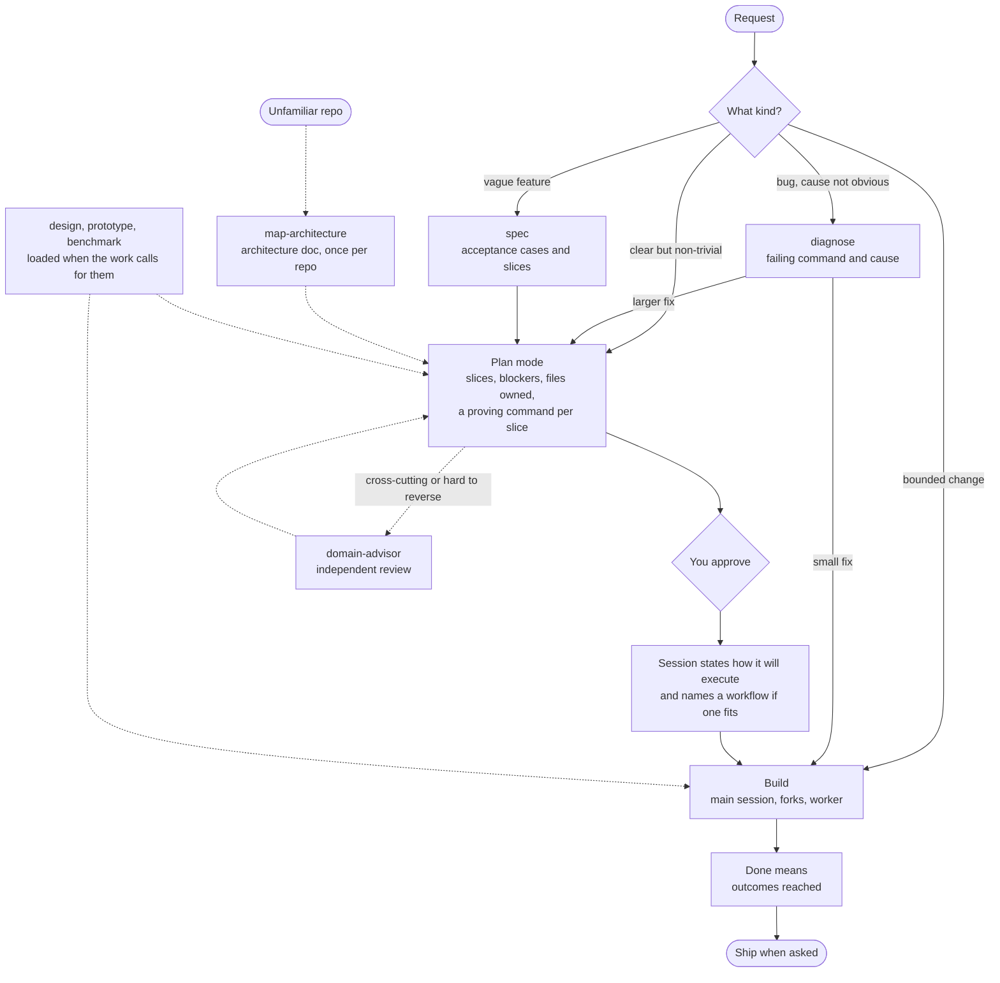

<div align="center">

# dotclaude

**A small Claude Code setup: one rules file, settings defaults, two agents and eight skills.**

The main session plans and builds. Nothing here replaces or restricts what Claude Code already ships.

[](LICENSE)
[](#skills)
[](https://claude.com/claude-code)

[Install](#install) · [Skills](#skills) · [Agents](#agents-and-models) · [Workflow](#workflow) · [Rules](#rules) · [Settings](#settings) · [Home repos](#home-repos) · [Credits](#credits)

</div>

<br>

This is my personal Claude Code configuration, symlinked into `~/.claude` by an installer that asks before each step.
It is three things:

- **Rules** in [`claude/CLAUDE.md`](claude/CLAUDE.md): how to write, what a finished change must have, and what to weigh when choosing how to execute a plan.
- **Settings defaults** in [`claude/settings.json`](claude/settings.json), merged into your own file without overwriting what you changed.
- **Skills** in [`skills/`](skills): one method each, for work the built-in commands do not teach.
- **Two agents** in [`agents/`](agents): `worker` and `domain-advisor`, which fix a model and an effort level and nothing else.

There are no hooks, and no agent or skill shadows a built-in.
Review, verification, planning and memory are left to `/code-review`, `/run`, plan mode and auto memory.

<br>

## Install

```bash
git clone https://github.com/theishandubey/dotclaude.git ~/dotclaude
~/dotclaude/install.sh --dry-run
~/dotclaude/install.sh
```

The installer works in steps and asks before each one.
Answer `y` to apply a step, `s` to skip it, or `q` to stop.

| Step | What it does |
|:--|:--|
| Agents, skills and CLAUDE.md | Links `~/.claude/CLAUDE.md`, one link per agent into `~/.claude/agents/` and one per skill into `~/.claude/skills/`. Removes links this repo no longer provides. |
| Settings | Merges the defaults into `~/.claude/settings.json` and shows the diff first. Removes hook entries whose script under `~/.claude/hooks/` no longer exists. |
| tmux | Links `~/.tmux.conf`, or adds one `source-file` line to your existing tmux config. |
| Third-party skills | Installs the skills recorded in [`skills-lock.json`](skills-lock.json) that are missing, through the `skills` CLI. |
| Unrecorded skills | Lists skills you installed with the CLI that the lock file does not record, and lets you pick which to add. |

<details>
<summary>More setup details</summary>

<br>

- `--dry-run` prints every step and command and changes nothing.
- `--yes` applies every step without asking, for a fresh machine or a script.
- Without a terminal and without `--yes`, the installer runs as a dry run and says so.
- `~/.claude/agents` and `~/.claude/skills` stay real directories, so your own agents and skills live next to the linked ones.
- Anything of yours already at a target is moved to `~/.dotclaude-backups/<timestamp>/`, never overwritten. Those lines are marked `backup`.
- `./install.sh --uninstall` removes the links, restores the newest backups, removes the defaults you did not change, and removes the tmux line. Third-party skills are left installed.
- **Needs:** macOS or Linux, `git`, Python 3.8 or later. Node 18 or later is needed only for the third-party skills step, which is skipped with a warning when `npx` is missing. `tmux` 3.3 or later is optional.

</details>

<details>
<summary>How settings are merged</summary>

<br>

The installer records the defaults it applied in `~/.claude/dotclaude-state.json` and does a three-way merge on every run, between the previously applied defaults, your file and the new defaults.

- A value you never changed follows the repo, including removal when the repo drops it.
- A value you changed or removed stays as you left it.
- List entries merge one by one, so your own allow rules and hooks survive.
- Every install is a clean one: a hook entry whose script under `~/.claude/hooks/` is missing is removed, whoever added it. Hooks that run anything else are kept.
- Plugin and marketplace entries an older version of this repo set are now yours and are left alone.

</details>

<details>
<summary>How third-party skills are handled</summary>

<br>

Third-party skills are never committed here.
`skills-lock.json` records where each one comes from, and the installer restores a missing one with a pinned CLI version:

```bash
npx skills@1.8.1 add <source> -g -a claude-code -s <name>
```

It never runs `update` and never removes a skill.
A recorded skill with the same name as one in `skills/` is skipped, because the repo's copy wins.

</details>

<br>

## Skills

Claude Code loads a skill when your request matches its description.
You do not call them by name, except `setup-home-repo`, which runs only when typed.

### Understanding and fixing

| Skill | What it does |
|:--|:--|
| [**map-architecture**](skills/map-architecture/SKILL.md) | One architecture document with Mermaid diagrams where every node, edge and state points at `path:line` on a pinned commit. State machines are drawn from a table of every write to the state field, and a script checks the references. |
| [**diagnose**](skills/diagnose/SKILL.md) | A failing check before any theory, the fix at the first place things went wrong, and a measured failure rate for flaky tests instead of retries. |
| [**benchmark**](skills/benchmark/SKILL.md) | Seven questions a performance number has to survive before it is reported. |

### Deciding what to build

| Skill | What it does |
|:--|:--|
| [**spec**](skills/spec/SKILL.md) | Interviews you in rounds with a recommended answer per question, then writes acceptance cases, a test plan and thin slices with their blockers. |
| [**design**](skills/design/SKILL.md) | Caller usage first, two structurally different designs before choosing, and a list of shapes to reject. |
| [**prototype**](skills/prototype/SKILL.md) | The smallest throwaway that answers one design question, then a report and a delete. |

### Writing and workspace

| Skill | What it does |
|:--|:--|
| [**unslop**](skills/unslop/SKILL.md) | Cuts AI tells from anything a person will read. |
| [**setup-home-repo**](skills/setup-home-repo/SKILL.md) | Turns a folder of repos into a private repo that versions their shared plans, specs and architecture docs. Typed only: `/setup-home-repo`. |

Recorded third-party skills, installed globally by the installer: [`agent-browser`](https://github.com/vercel-labs/agent-browser) for driving a browser, [`shadcn`](https://github.com/shadcn/ui) and [`improve`](https://github.com/shadcn/improve), [`portless`](https://github.com/vercel-labs/portless) for named local dev URLs, and the seven animation and interface design skills from [emilkowalski/skill](https://github.com/emilkowalski/skill).

<br>

## Agents and models

The main session plans, on whichever model you start it with.
Two agents and one setting decide where the rest runs:

| Need | Goes to | Model |
|:--|:--|:--|
| A self-contained slice with known files and a proving command | [`worker`](agents/worker.md) | Sonnet, high effort |
| An independent review of a cross-cutting or hard-to-reverse plan | [`domain-advisor`](agents/domain-advisor.md), told which domain to review as | Opus, high effort |
| A stronger opinion mid-task | The built-in advisor, set by `advisorModel` | Fable |
| Codebase search | The built-in Explore agent, dispatched with `model: sonnet` and `effort: medium` | Sonnet, medium effort |
| A side task that needs the session's context | A fork | The session's model |

The session can pass a stronger model on a single dispatch, for a slice that failed twice.
Neither agent restricts tools.

<br>

## Workflow



This is the usual path, not a fixed route: skills load when a request matches them, and a bounded change skips planning.
Each stage hands the next a file or a command: the architecture doc informs the plan, the failing command from `diagnose` becomes a proving command, and the acceptance cases from `spec` become the final check.
Approving the plan starts the build; there is no separate build command.
The session decides how to execute (alone, forks, `worker` agents, worktrees, `/batch` or a team) and says so first.
A scripted workflow runs only if you answer "use a workflow".

<br>

## Rules

[`claude/CLAUDE.md`](claude/CLAUDE.md) is loaded in every session.
Each rule is a default with its reason, and none forbids a built-in agent, skill or command.

| Section | What it settles |
|:--|:--|
| Writing | No em dashes, no code comments that restate the code, one sentence per line in long Markdown. |
| Orchestration | The session holding the plan decides whether to work alone, fork, use `worker` agents, worktrees, `/batch` or a team, and says which before starting. The file gives it defaults for which model does what and facts to weigh, not a route. |
| Plans | What a plan must contain and where plans and notes live. |
| Working in a repo | Notes go in the repo's `.claude/`, kept out of git through `.git/info/exclude`. |
| Done means | Seven outcomes a finished change must have: a reproduced bug, unit tests, a green final run, one real run, an independent review, measured speed claims, no ignored failures. |
| Shipping, Learning, Safety, Environment | Atomic commits staged by name, corrections saved to memory, a confirmation before destructive commands, scratch files outside the repo. |
| Principles, Commits and branches | Subtraction first, one place per decision, commit messages that describe the change. |

<br>

## Settings

[`claude/settings.json`](claude/settings.json) sets these defaults; change any of them in `~/.claude/settings.json` and your value is kept.

- No `defaultMode`, so sessions start in the built-in auto mode. This repo registers no guard hooks, so do not pair it with bypass mode unless you accept that nothing stands between a mistaken command and the disk.
- `"skipDangerousModePermissionPrompt": true`, so switching a session into bypass mode does not ask for confirmation first.
- `"attribution": false`, so commits and PRs carry no co-author trailer.
- The model aliases are pinned: Fable to 5.2, and Opus, Sonnet and Haiku to 5.5.
- `CLAUDE_AUTOCOMPACT_PCT_OVERRIDE` is `30`, so a conversation is compacted once it fills 30% of the auto-compact window.
- `"advisorModel": "fable"`, so a session on Opus or Sonnet can consult Fable mid-task. The advisor is experimental and each call is billed at Fable's rate.
- Agent teams enabled, worktrees based on the current `HEAD`, and an allow list for common build and git commands.
- The owner's taste: the `opus` model, the `latest` update channel, the fullscreen TUI, the dark theme and notifications.

Check what a session costs with the built-in commands: `/context` for what is loaded at start, `/usage` for spend, `/skill-doctor` for skills that never fire or load too much, and `/doctor prompt-audit` for the rules file.

<br>

## Home repos

A home repo is a small private git repo at the root of a folder that holds several repos.
It commits a `CLAUDE.md` with an "Other repos" table and a `.claude/` folder of plans, specs, architecture docs and decisions; the child repos stay ignored and keep their own history.

Start Claude Code in the workspace folder and type `/setup-home-repo`.
Run it again later to refresh the table; your notes in it are kept.

This repo is public, so it is not a home repo itself and holds no pointers to private work.

<br>

## Development

```bash
scripts/check.sh
```

It compiles every script, lints the shell files when `shellcheck` is installed, and runs the tests: the installer in a throwaway `HOME` with a fake `npx`, both skill scripts, and checks that no agent, skill or settings default restricts a built-in capability.

<br>

## Credits

The skills are written fresh, but their methods come from other people's work.

| Skill | Ideas from |
|:--|:--|
| diagnose | [mattpocock/skills](https://github.com/mattpocock/skills) `diagnosing-bugs`; [pstack](https://github.com/cursor/plugins/tree/main/pstack) bug-fix playbook, `principle-fix-root-causes`, `principle-attack-the-premise`; [simcraft](https://github.com/dotslashsimran/simcraft) `flaky-test-killer` |
| spec | mattpocock/skills `grilling`, `to-spec`, `to-tickets`; [gstack](https://github.com/garrytan/gstack) `office-hours`, `plan-eng-review`; pstack `poteto-mode` |
| design | pstack `architect`; mattpocock/skills `codebase-design`, `domain-modeling` |
| prototype | mattpocock/skills `prototype`; pstack prototype playbook |
| benchmark | pstack `benchmark-checklist`; simcraft `benchmark-honestly` |
| map-architecture | simcraft `codebase-map`; [archify](https://github.com/tt-a1i/archify) |
| unslop | Adapted from pstack `unslop`, with its license in the skill folder |
| setup-home-repo | The home repo pattern described on [aihero.dev](https://www.aihero.dev) |

mattpocock/skills, pstack, simcraft and gstack are MIT licensed; archify is Apache-2.0.

## License

[MIT](LICENSE)
