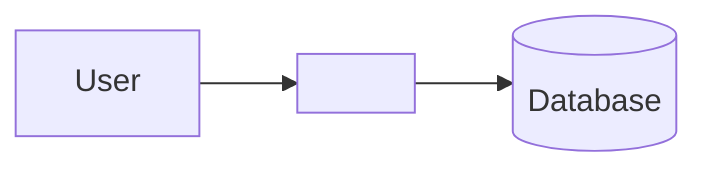
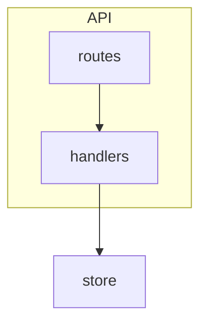
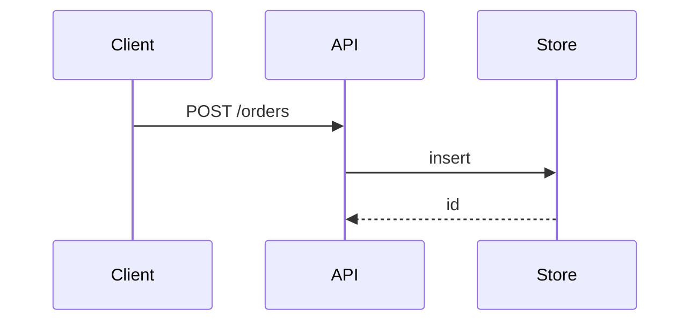
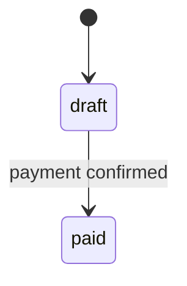
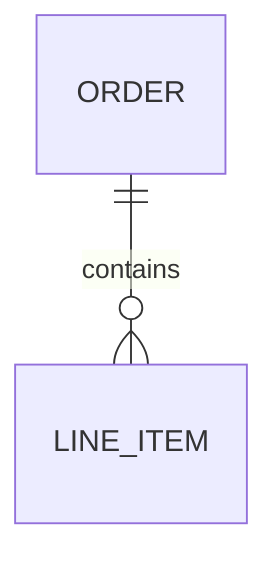
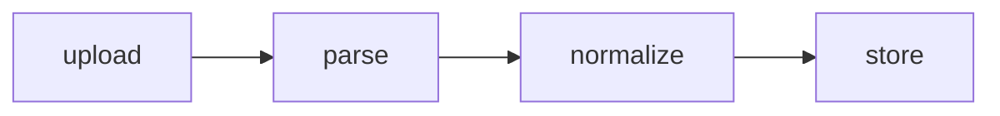

# Architecture: <repo>

Commit: `<sha>`

<One paragraph: who uses it, what goes in, what comes out, what it talks to.>

Every `path:line` below was read at the commit above.
Claims marked **ran** were seen in a run; unmarked claims were read in the code; claims marked **inferred** were not confirmed.

## System context

| Edge | Where |
|---|---|
| app to db | `src/db.py:14` |

## Components

| Component | Responsibility | Where |
|---|---|---|
| routes | Maps URLs to handlers | `src/routes.py:8` |

## Request trace: <one real request>

| Hop | What happens | Where |
|---|---|---|
| 1 | Request is parsed and validated (**ran**) | `src/handlers.py:31` |

## State machine: <entity>

The table lists every write to `<entity>.<field>` found in the code; the diagram is drawn from it.

| From | To | Guard | Where |
|---|---|---|---|
| `[*]` | `draft` | on create | `src/orders.py:20` |
| `draft` | `paid` | payment confirmed | `src/orders.py:58` |

Findings: <states no code writes, states with no way in or out, or "none">.

## Data model

| Entity | Key | Where |
|---|---|---|
| ORDER | `id` | `migrations/001_orders.sql:3` |

## Data flow

| Stage | What changes | Where |
|---|---|---|
| parse | Bytes become rows | `src/ingest.py:44` |

## Not traced

<What was left out, and anything inferred rather than observed.>
